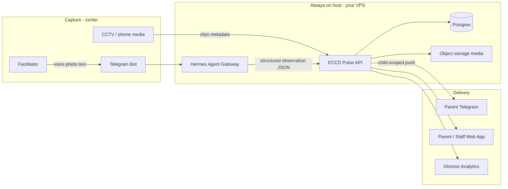

# Bhutan ECCD Pulse — Architecture

## Problem

ECCD centers in Bhutan often have **few facilitators and many children**. Parents want **updates about their child** — milestones, mood, photos, short clips, home guidance — not generic “class had a good day” posts. Staff cannot write dozens of individual notes by hand.

**North star:** one staff action → many parent-specific outcomes.

## Actors

| Actor | Job |
|---|---|
| Facilitator | Capture voice/photo in Telegram in seconds; confirm AI mapping to child + MoESD ELDS |
| Parent | Receive only their child’s moments; ask Hermes “how was Tashi today?” |
| Director / MoESD | Aggregate ELDS readiness (anonymized), not individual child gossip |

## System diagram

## Domain model (child is the unit of privacy)

- **Center** → Facilitators, Rooms, Children, ParentGuardians
- **Child** → ELDS domain scores, triggers, milestones, consent flags
- **Observation** (from Hermes): structured ELDS extraction (`source`: `voice` | `photo` | `cctv`)
- **Moment** (parent-facing): approved subset of Observation + optional media URLs, tagged to **one** child
- **Delivery**: parent only sees Moments where `guardian.childIds` contains that child

**Hard rule:** no center-wide feed as the primary parent UX — always child-scoped.

Contract file: [`hermes-observation-schema.json`](./hermes-observation-schema.json)

## Thin-slice demo (this repo)

Runnable Vite + React UI with in-memory stubs in [`src/lib/pulseApi.ts`](../src/lib/pulseApi.ts):

| Stub | Future HTTP |
|---|---|
| `createObservationFromHermes` | `POST /observations/from-hermes` |
| `confirmMoment` | `POST /moments/:id/confirm` |
| `getParentMoments` | `GET /parents/:guardianId/moments` |

Demo path: Facilitator → Voice scenario → **Confirm Log to Profile** → Parent portal shows that child’s new moment (+ simulated Telegram toast).

## Hosting checklist (Hermes + Telegram on your VPS)

See [`hermes-hosting-checklist.md`](./hermes-hosting-checklist.md).

## Capture paths (phased)

1. **Phase A (voice — vertical slice):** Telegram voice → Hermes → Observation → Confirm → Moment → parent notify  
2. **Phase B (media):** photos/short videos + child tag → confirm → object storage → parent media push  
3. **Phase C (CCTV — privacy-first):** buffered clips → staff/Hermes select moment → consent + approval → parent gets clip only; live view staff/director-only with audit  

Details: [`roadmap-phases.md`](./roadmap-phases.md)

## AI responsibilities (Hermes)

- Parse voice → child, behavior, strategy, ELDS domain
- Draft **parent-safe** language (warm, specific, no other children’s names)
- Facilitator co-pilot grounded in the active child’s profile
- Optional nightly/weekly digest cron per opted-in child

Sample skill prompt: [`hermes-skill-prompt.md`](./hermes-skill-prompt.md)

## Out of scope for the thin slice

- Real CCTV hardware integration
- Production auth / MoESD SSO
- Face recognition training
- Multi-center SaaS billing
