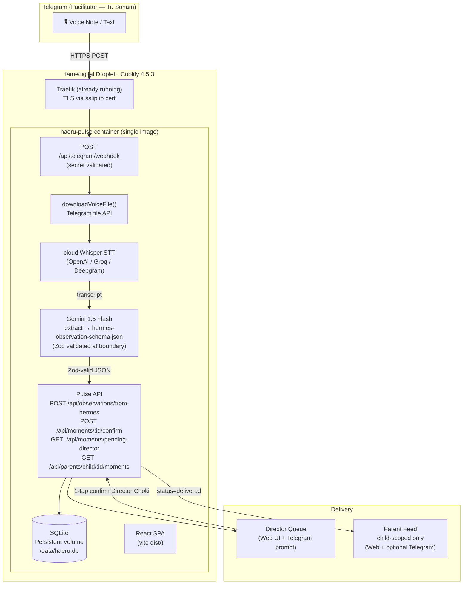
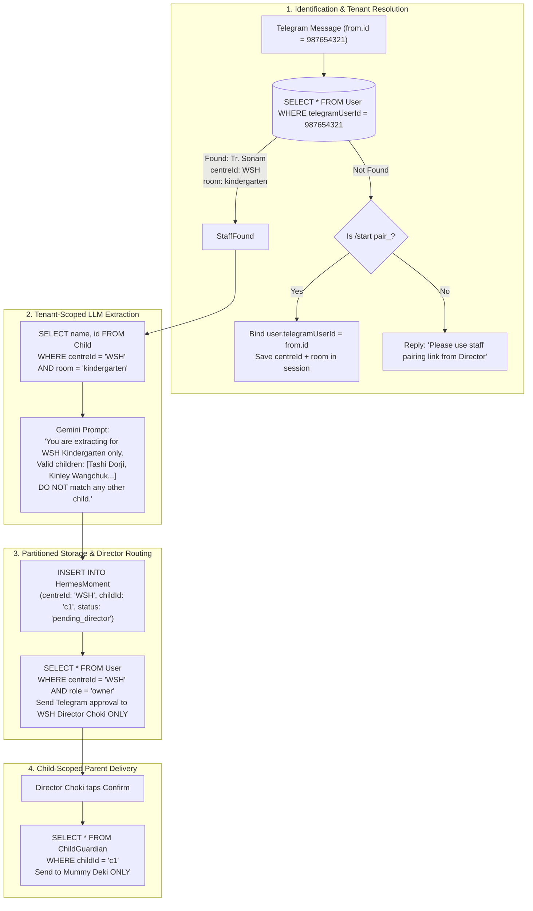

# Haeru — Live Voice AI on DigitalOcean Coolify (Multi-Tenant Enterprise Architecture)
### Cursor Implementation Plan
**Date**: 2026-11-02 | **Status**: Ready for Cursor  
**Droplet**: `famedigital` · `165.22.211.20` · Coolify 4.5.3 + Traefik  
**Brand**: Haeru Voice AI · Internal codename: Hermes · Bot: `@HaeruEccdBot`

---

## 1. Executive Summary

1. **Smallest winning path**: Facilitator sends a Telegram voice note → Haeru bot transcribes (cloud Whisper API) → Gemini extracts structured ELDS JSON → Director confirms 1-tap → parent sees only their child's moment.
2. **Zero Cross-School Mixing (Multi-Tenant)**: Uses Telegram deep-link pairing (`/start pair_<token>`) to bind staff to their school (`centreId`). When Tr. Sonam speaks, Gemini only receives the roster for *her school and room*. Director notifications route *only to that school's Director*.
3. **Ship target**: Single Docker image = React SPA + Pulse API + Telegram webhook worker; deployed on famedigital Coolify via `haeru.<sslip-host>`.
4. **Isolation guarantee**: Haeru runs in its own Coolify application, port-isolated from Innora. No shared Supabase. No domain purchase needed.
5. **Director gate is non-negotiable**: Status machine `pending_facilitator → pending_director → delivered`. Parent feed reads `delivered` only.
6. **Phase A vertical slice only**: voice → ELDS → confirm → parent. Photos (Phase B) and CCTV (Phase C) explicitly out of pilot scope.

---

## 2. Success Metrics

| Metric | Target | How Tested |
|---|---|---|
| Facilitator capture time | ≤ 15 seconds voice note to "pending in queue" | Real Tr. Sonam at WSH Kindergarten |
| Director confirm latency | ≤ 30 seconds via Telegram inline button OR web tap | Director Choki persona |
| End-to-end latency | Voice note → parent feed ≤ 90 seconds | Stopwatch test with Tashi persona |
| Peer privacy | 0 other children's names in any parent delivery | Automated test in smoke suite |
| Pre-director delivery | 0 moments reach parent before `isConfirmed = true` | P0 unit test |
| Webhook survival | Bot still alive after Coolify redeploy | Health probe script |
| Build gate | `npm run build` exits code 0 after every phase | CI / pre-commit |

---

## 3. Architecture — Pilot



### Key Architectural Decisions

| Decision | Rationale |
|---|---|
| Single container (SPA + API + webhook) | Simplest Coolify deploy; split to `web+worker` only if STT latency blocks HTTP |
| Webhook mode (not long-poll) | Reliable on always-on VPS; survives redeploy if webhook re-registers on boot |
| Cloud STT (OpenAI Whisper / Groq) | Saves famedigital CPU; Innora stays stable |
| Gemini 1.5 Flash for extraction | Fast, cheap, supports Dzongkha colloquial understanding |
| SQLite on persistent volume | Good enough for pilot (single school); migrate to Postgres if multi-centre |
| `sslip.io` free HTTPS | No domain purchase; Traefik handles TLS via ACME |

---

## 3.1. Multi-Tenant Architecture — Zero Cross-School Mix-Up Guarantee

### The Core Problem
When 10 ECCD centres (WSH Thimphu, Little Gems Paro, Druk Care Phuentsholing, etc.) all use `@HaeruEccdBot`:
- Multiple schools have children named *"Tashi"* or *"Kinley"*.
- If a facilitator sends a voice note, how does Haeru know which school she belongs to?
- How do we ensure School A's Director never sees School B's observations?
- How do we ensure School A's parents never receive School B's children's updates?

### The 4 Enterprise Multi-Tenant Pillars



1. **Telegram Deep-Link Pairing (`/start pair_<token>`)**:
   - In Director Portal: Director taps *"Generate Staff Pairing Link"* for Tr. Sonam.
   - Generates unique link: `https://t.me/HaeruEccdBot?start=pair_wsh_sonam_8f9a2`.
   - Tr. Sonam opens link in Telegram and taps **Start**.
   - Telegram sends: `/start pair_wsh_sonam_8f9a2`.
   - Server resolves token, permanently links `User.telegramUserId = update.message.from.id` and `User.telegramChatId = update.message.chat.id`.
   - From that moment on, every voice note from Tr. Sonam is automatically tagged with `centreId: 'WSH'` and `room: 'kindergarten'`.

2. **Roster-Scoped LLM Extraction**:
   - Before calling Gemini, server queries `Child` table filtered strictly by `WHERE centreId = user.centreId AND room = user.room`.
   - Gemini only receives the 15 children enrolled in that specific room.
   - Gemini is physically incapable of confusing Tashi in Thimphu with a Tashi in Paro.

3. **Tenant-Scoped Director Queue**:
   - `GET /api/moments/pending-director` requires `X-Centre-Code: WSH` or authenticated session.
   - Database query: `WHERE centreId = :centreId AND status = 'pending_director'`.
   - Director Telegram notifications only go to `User` rows `WHERE centreId = user.centreId AND role = 'owner'`.

4. **Child-Atomic Parent Feed**:
   - Parent delivery only reads `ChildGuardian` records for the specific `childId` in that `centreId`.
   - Parents have zero cross-school or cross-child visibility.

---

## 4. Phased Build Plan

### ─── Phase P0: Production Container ───────────────────────────────

**Goal**: App running on Coolify with HTTPS, health probe passing. No Telegram yet.

#### P0.1 — Node.js production server (`server.mjs`)

**Create**: `server.mjs` (project root)

```
Root:
  server.mjs          ← new: ESM Node HTTP server (serves dist/ + API)
  Dockerfile          ← new
  .dockerignore       ← new
  .env.example        ← update with all new vars
```

`server.mjs` must:
- `import { createServer } from 'node:http'`
- Load `src/server/pulseHttp.ts` compiled output (or re-export via adapter)
- Serve `dist/` static files for all non-`/api/` routes (SPA fallback to `index.html`)
- Mount `/api/*` through the existing `handlePulseHttp` logic
- Mount `POST /api/telegram/webhook` (added in P1)
- Listen on `process.env.PORT || 3000`
- Expose `GET /health` → `200 { ok: true, ts: Date.now() }`

> **Note**: Because the current codebase uses Vite SSR to run `src/server/pulseHttp.ts` (TypeScript), the production server must either:
> - **Option A (preferred)**: Add a separate `server/` folder compiled by `tsc` into `dist-server/`; adjust `package.json#build` to run `tsc -p tsconfig.server.json && vite build`
> - **Option B**: Use `tsx` at runtime (`node --import tsx/esm server.mjs`)

**Use Option A** — clean, no runtime TS dependency.

#### P0.2 — `tsconfig.server.json`

```jsonc
{
  "extends": "./tsconfig.json",
  "compilerOptions": {
    "module": "NodeNext",
    "moduleResolution": "NodeNext",
    "outDir": "dist-server",
    "rootDir": "src/server",
    "target": "ES2022",
    "noEmit": false
  },
  "include": ["src/server/**/*.ts"]
}
```

#### P0.3 — `Dockerfile`

```dockerfile
# ── Stage 1: Build ──────────────────────────────────────────────
FROM node:22-alpine AS builder
WORKDIR /app

# Install deps (incl. prisma for generate)
COPY package*.json ./
RUN npm ci

# Copy everything
COPY . .

# Generate Prisma client + build SPA + compile server
RUN npm run prisma:generate
RUN npm run build
# Compile server TypeScript → dist-server/
RUN npx tsc -p tsconfig.server.json

# ── Stage 2: Runtime ────────────────────────────────────────────
FROM node:22-alpine AS runtime
WORKDIR /app

# Production dependencies only
COPY package*.json ./
RUN npm ci --omit=dev

# Copy built artefacts
COPY --from=builder /app/dist ./dist
COPY --from=builder /app/dist-server ./dist-server
COPY --from=builder /app/backend/prisma ./backend/prisma
COPY --from=builder /app/node_modules/.prisma ./node_modules/.prisma

# Data volume mount point
RUN mkdir -p /data

# Server entrypoint
COPY server.mjs ./server.mjs

EXPOSE 3000
HEALTHCHECK --interval=30s --timeout=5s --start-period=10s \
  CMD wget -qO- http://localhost:3000/health || exit 1

CMD ["node", "server.mjs"]
```

#### P0.4 — `.dockerignore`

```
node_modules/
dist/
dist-server/
backend/prisma/dev.db
.env
.cursor/
docs/
public/
*.log
```

#### P0.5 — Coolify App Configuration

In Coolify UI → New Application → Docker Image (or Git + Dockerfile):

| Field | Value |
|---|---|
| App name | `haeru-pulse` |
| Dockerfile path | `./Dockerfile` |
| Port | `3000` |
| Domain | `haeru.165-22-211-20.sslip.io` (or Coolify-generated) |
| Health check path | `/health` |
| Volume | `/data` → persistent (for SQLite) |
| Environment | See Section 6 |

#### P0.6 — Prisma SQLite on Persistent Volume

Update `backend/prisma/schema.prisma` datasource `url`:

```
url = env("DATABASE_URL")
```

Set `DATABASE_URL=file:/data/haeru.db` in Coolify environment.

Add migration step in `server.mjs` boot:

```js
import { execSync } from 'node:child_process'
execSync('npx prisma db push --schema backend/prisma/schema.prisma', { stdio: 'inherit' })
```

#### P0.7 — Multi-Tenant Schema Additions for Hermes (add to `schema.prisma`)

Update `schema.prisma` to include multi-tenant columns and the `HermesMoment` table:

```prisma
// Update User model:
model User {
  id              String            @id @default(uuid())
  centreId        String            @default("WSH") // Multi-tenant anchor
  name            String
  role            String            // owner | facilitator | parent | caregiver
  email           String?           @unique
  phone           String            @unique
  room            String?           // toddlers | nursery | kg
  telegramUserId  String?           @unique // numeric Telegram ID from message.from.id
  telegramChatId  String?           @unique // chat_id for sending notifications
  pairingToken    String?           @unique // unique token for /start pair_<token>
  // ... existing fields and relations
  centre          Centre            @relation(fields: [centreId], references: [id])
}

// Update Child model:
model Child {
  id                 String            @id @default(uuid())
  centreId           String            @default("WSH") // Multi-tenant anchor
  code               String            @unique
  name               String
  room               String            // toddlers | nursery | kg
  // ... existing fields
  centre             Centre            @relation(fields: [centreId], references: [id])
  moments            HermesMoment[]
}

// Add HermesMoment model:
model HermesMoment {
  id              String   @id @default(uuid())
  centreId        String   @default("WSH") // Multi-tenant isolation anchor
  telegramMsgId   Int?
  telegramChatId  String?
  transcription   String?
  rawHermesJson   String   // full JSON from extractor
  childId         String?
  childName       String
  domain          String
  source          String   @default("voice") // voice | photo | cctv
  /// pending_facilitator | pending_director | delivered | rejected
  status          String   @default("pending_director")
  facilitatorTgId String?  // Telegram user ID of sender
  confirmedById   String?
  confirmedAt     DateTime?
  createdAt       DateTime @default(now())
  child           Child?   @relation(fields: [childId], references: [id])
  centre          Centre   @relation(fields: [centreId], references: [id])

  @@index([centreId, status])
  @@index([childId])
}
```

**P0 Acceptance**: `curl https://haeru.165-22-211-20.sslip.io/health` → `{"ok":true}`

---

### ─── Phase P1: Telegram Webhook + STT ─────────────────────────────

**Goal**: Facilitator sends a voice note to the bot → transcript appears in server logs / Director queue stub.

#### P1.1 — New route: `POST /api/telegram/webhook`

**Create**: `src/server/telegramWebhook.ts`

Responsibilities:
1. Validate `X-Telegram-Bot-Api-Secret-Token` header against `TELEGRAM_WEBHOOK_SECRET`
2. Parse Telegram `Update` body (typed with a minimal local type, no heavy SDK needed)
3. **Allowlist check**: `update.message.from.id` must be in `TELEGRAM_ALLOWED_USERS` (comma-separated). Reject silently if not in list.
4. Route by message type:
   - `voice` → `handleVoice(update)`
   - `audio` → same as voice
   - `text` starting with `/start` → reply "Welcome to Haeru Voice AI 👋"
   - other → ignore
5. Immediately return `200 OK` to Telegram (never timeout Telegram's 5s window)

```typescript
// src/server/telegramWebhook.ts
import type { IncomingMessage, ServerResponse } from 'node:http'

export async function handleTelegramWebhook(
  req: IncomingMessage,
  res: ServerResponse,
  body: unknown,
): Promise<void> {
  // 1. Secret validation
  const secret = req.headers['x-telegram-bot-api-secret-token']
  if (secret !== process.env.TELEGRAM_WEBHOOK_SECRET) {
    res.writeHead(403).end('Forbidden')
    return
  }

  // 2. Always ACK first — then process async
  res.writeHead(200, { 'Content-Type': 'application/json' }).end('{"ok":true}')

  // 3. Fire-and-forget pipeline
  void processTelegramUpdate(body as TelegramUpdate).catch((err) =>
    console.error('[Hermes] pipeline error', err),
  )
}
```

#### P1.2 — `processTelegramUpdate` pipeline (Multi-Tenant Aware)

**Create**: `src/server/hermesPipeline.ts`

```
processTelegramUpdate(update)
  ├── 1. RESOLVE USER & TENANT:
  │     fromId = update.message?.from?.id?.toString()
  │     user = await prisma.user.findUnique({ where: { telegramUserId: fromId } })
  │
  ├── 2. IF NOT PAIRED YET:
  │     if update.message?.text?.startsWith('/start pair_'):
  │       token = text.replace('/start pair_', '')
  │       targetUser = await prisma.user.findUnique({ where: { pairingToken: token } })
  │       if (targetUser):
  │         await prisma.user.update({
  │           where: { id: targetUser.id },
  │           data: { telegramUserId: fromId, telegramChatId: chatId, pairingToken: null }
  │         })
  │         sendMessage(chatId, "✅ Paired with " + targetUser.name + " @ " + targetUser.centreId)
  │         return
  │     else:
  │       sendMessage(chatId, "👋 Welcome to Haeru Voice AI! To pair your account, click the link from your Director.")
  │       return
  │
  ├── 3. IF VOICE / AUDIO MESSAGE:
  │     downloadVoiceFile(file_id) → Buffer
  │     transcribeAudio(buffer, mimetype) → string
  │     // MULTI-TENANT ROSTER: ONLY children in this school and classroom!
  │     classroomRoster = await prisma.child.findMany({
  │       where: { centreId: user.centreId, room: user.room },
  │       select: { id: true, name: true }
  │     })
  │     extractObservation(transcript, classroomRoster) → HermesObservation (Zod validated)
  │     saveHermesMoment(observation, user.centreId, chatId, msgId, fromId)
  │     sendMessage(chatId, "✅ Haeru received " + obs.childName + "'s moment — awaiting Director review")
  │     notifyDirector(moment, user.centreId)
  │
  └── 4. IF CALLBACK QUERY (Director Confirmation):
        data = update.callback_query.data // "confirm:momentId" | "reject:momentId"
        confirmMomentAndDeliver(momentId, callbackFromId)
```

#### P1.3 — `downloadVoiceFile`

```typescript
// src/server/hermesDownload.ts
export async function downloadVoiceFile(fileId: string): Promise<Buffer> {
  const token = process.env.TELEGRAM_BOT_TOKEN!
  // 1. getFile → file_path
  const fileRes = await fetch(`https://api.telegram.org/bot${token}/getFile?file_id=${fileId}`)
  const { result } = await fileRes.json() as { result: { file_path: string } }
  // 2. download bytes
  const dlRes = await fetch(`https://api.telegram.org/file/bot${token}/${result.file_path}`)
  return Buffer.from(await dlRes.arrayBuffer())
}
```

#### P1.4 — `transcribeAudio` — Cloud STT

**Create**: `src/server/hermesSTT.ts`

Support two providers via env var `STT_PROVIDER`:

| Provider | Env Var | Notes |
|---|---|---|
| `openai` (default) | `OPENAI_API_KEY` | Whisper-1 via form-data |
| `groq` | `GROQ_API_KEY` | `whisper-large-v3-turbo`, faster + cheaper |
| `deepgram` | `DEEPGRAM_API_KEY` | Best for noisy environments |

```typescript
// src/server/hermesSTT.ts
export async function transcribeAudio(audio: Buffer, filename = 'voice.ogg'): Promise<string> {
  const provider = process.env.STT_PROVIDER ?? 'openai'
  if (provider === 'groq') return transcribeGroq(audio, filename)
  if (provider === 'deepgram') return transcribeDeepgram(audio)
  return transcribeOpenAI(audio, filename)
}
```

All three implementations use `FormData` + fetch — no heavy SDKs needed.

#### P1.5 — `extractObservation` — Gemini LLM

**Create**: `src/server/hermesExtractor.ts`

```typescript
import { z } from 'zod'

// Zod schema mirroring docs/hermes-observation-schema.json
export const HermesObservationSchema = z.object({
  childId:         z.string().optional(),
  childName:       z.string().min(1),
  domain:          z.string().min(1),
  trigger:         z.string(),
  strategy:        z.string(),
  milestone:       z.string(),
  confidence:      z.string(),
  source:          z.enum(['voice', 'photo', 'cctv']),
  transcription:   z.string().optional(),
  parentSafeTitle: z.string().optional(),
  parentSafeDesc:  z.string().optional(),
  rawRef:          z.string().optional(),
  mediaUrls:       z.array(z.string().url()).optional(),
})

export type HermesObservation = z.infer<typeof HermesObservationSchema>

export async function extractObservation(
  transcript: string,
  childRoster: string[], // names of enrolled children for disambiguation
): Promise<HermesObservation> {
  const systemPrompt = buildSystemPrompt(childRoster) // from hermes-skill-prompt.md
  const response = await callGemini(systemPrompt, transcript)
  const json = JSON.parse(response)
  return HermesObservationSchema.parse(json) // throws ZodError if invalid
}
```

**Gemini call** uses `GEMINI_API_KEY` + `generativelanguage.googleapis.com` REST API (no SDK dependency):

```typescript
async function callGemini(system: string, user: string): Promise<string> {
  const model = process.env.GEMINI_MODEL ?? 'gemini-1.5-flash'
  const key = process.env.GEMINI_API_KEY!
  const url = `https://generativelanguage.googleapis.com/v1beta/models/${model}:generateContent?key=${key}`
  const res = await fetch(url, {
    method: 'POST',
    headers: { 'Content-Type': 'application/json' },
    body: JSON.stringify({
      systemInstruction: { parts: [{ text: system }] },
      contents: [{ role: 'user', parts: [{ text: user }] }],
      generationConfig: { responseMimeType: 'application/json' },
    }),
  })
  const data = await res.json() as { candidates: Array<{ content: { parts: Array<{ text: string }> } }> }
  return data.candidates[0]!.content.parts[0]!.text
}
```

#### P1.6 — Webhook Registration on Boot

**Create**: `src/server/hermesWebhookReg.ts`

```typescript
export async function registerTelegramWebhook(): Promise<void> {
  const token = process.env.TELEGRAM_BOT_TOKEN!
  const host = process.env.PUBLIC_URL! // e.g. https://haeru.165-22-211-20.sslip.io
  const secret = process.env.TELEGRAM_WEBHOOK_SECRET!
  const url = `${host}/api/telegram/webhook`

  const res = await fetch(`https://api.telegram.org/bot${token}/setWebhook`, {
    method: 'POST',
    headers: { 'Content-Type': 'application/json' },
    body: JSON.stringify({ url, secret_token: secret, allowed_updates: ['message', 'callback_query'] }),
  })
  const data = await res.json()
  console.log('[Hermes] webhook registration:', data)
}
```

Called once at `server.mjs` startup after DB push.

#### P1.7 — Wire webhook route into `pulseHttp.ts`

Add ONE new block in `handlePulseHttp` (do NOT create a separate server):

```typescript
if (req.method === 'POST' && url === '/api/telegram/webhook') {
  const raw = await readBody(req)
  const json = raw ? JSON.parse(raw) : {}
  await handleTelegramWebhook(req, res, json)
  return true
}
```

**P1 Acceptance**:
```bash
# After Coolify deploy:
curl -X POST https://haeru.165-22-211-20.sslip.io/api/telegram/webhook \
  -H "X-Telegram-Bot-Api-Secret-Token: $TELEGRAM_WEBHOOK_SECRET" \
  -H "Content-Type: application/json" \
  -d '{"update_id":1,"message":{"message_id":1,"from":{"id":123},"text":"/start","date":1}}'
# → {"ok":true}

# Real test: Tr. Sonam sends 15s voice note to @HaeruEccdBot
# Expect: "✅ Haeru received..." reply within 30s
```

---

### ─── Phase P2: Director Queue → Confirm → Parent Feed ─────────────

**Goal**: Full end-to-end privacy-correct pipeline.

#### P2.1 — `saveHermesMoment` — write to DB

**Create**: `src/server/hermesMomentStore.ts`

```typescript
import { prisma } from './prisma'

export async function saveHermesMoment(
  obs: HermesObservation,
  chatId: string,
  tgMsgId: number,
  facilitatorTgId: string,
): Promise<{ momentId: string; childId: string | null }> {
  // 1. Resolve childId from childName (fuzzy match against Child table)
  const child = await resolveChild(obs.childName)

  // 2. Create HermesMoment
  const moment = await prisma.hermesMoment.create({
    data: {
      telegramMsgId:  tgMsgId,
      telegramChatId: chatId,
      transcription:  obs.transcription,
      rawHermesJson:  JSON.stringify(obs),
      childId:        child?.id ?? null,
      childName:      obs.childName,
      domain:         obs.domain,
      source:         obs.source,
      status:         'pending_director',
      facilitatorTgId: facilitatorTgId,
    },
  })

  return { momentId: moment.id, childId: child?.id ?? null }
}

async function resolveChild(name: string) {
  // Case-insensitive name match — pilot has small roster
  const all = await prisma.child.findMany()
  return all.find((c) =>
    c.name.toLowerCase().includes(name.toLowerCase()) ||
    name.toLowerCase().includes(c.name.split(' ')[0]!.toLowerCase()),
  ) ?? null
}
```

#### P2.2 — Director Notification

After saving, send the Director a Telegram message with an inline confirm button:

```typescript
// src/server/hermesDirectorNotify.ts
export async function notifyDirector(momentId: string, childName: string, domain: string): Promise<void> {
  const directorChatId = process.env.DIRECTOR_TELEGRAM_CHAT_ID!
  const token = process.env.TELEGRAM_BOT_TOKEN!

  await fetch(`https://api.telegram.org/bot${token}/sendMessage`, {
    method: 'POST',
    headers: { 'Content-Type': 'application/json' },
    body: JSON.stringify({
      chat_id: directorChatId,
      text: `📋 *New Observation*\n\n👦 ${childName}\n🎓 Domain: ${domain}\n\nReview and confirm to release to parent.`,
      parse_mode: 'Markdown',
      reply_markup: {
        inline_keyboard: [[
          { text: '✅ Confirm & Deliver', callback_data: `confirm:${momentId}` },
          { text: '❌ Reject',           callback_data: `reject:${momentId}` },
        ]],
      },
    }),
  })
}
```

#### P2.3 — Handle Director Callback Query

In `processTelegramUpdate`, handle `callback_query`:

```typescript
if (update.callback_query) {
  const data = update.callback_query.data ?? ''
  const [action, momentId] = data.split(':')

  if (action === 'confirm' && momentId) {
    await confirmMomentAndDeliver(momentId, update.callback_query.from.id.toString())
    await answerCallbackQuery(update.callback_query.id, '✅ Delivered to parent')
  }
  if (action === 'reject' && momentId) {
    await rejectMoment(momentId)
    await answerCallbackQuery(update.callback_query.id, '❌ Rejected')
  }
}
```

#### P2.4 — `confirmMomentAndDeliver`

```typescript
// src/server/hermesMomentStore.ts (extend)
export async function confirmMomentAndDeliver(momentId: string, confirmedByTgId: string): Promise<void> {
  const moment = await prisma.hermesMoment.update({
    where: { id: momentId },
    data: {
      status:      'delivered',
      confirmedAt: new Date(),
      confirmedById: confirmedByTgId,
    },
  })

  if (!moment.childId) {
    console.warn('[Hermes] confirmed moment has no resolved childId — parent delivery skipped')
    return
  }

  // Fan-out: deliver only to guardians of this child
  const raw = JSON.parse(moment.rawHermesJson) as HermesObservation
  await deliverToParents(moment.childId, raw)
}
```

#### P2.5 — `deliverToParents` — child-scoped Telegram delivery

```typescript
// src/server/hermesParentDelivery.ts
export async function deliverToParents(childId: string, obs: HermesObservation): Promise<void> {
  const token = process.env.TELEGRAM_BOT_TOKEN!

  // Load guardians who have a Telegram chat ID stored
  const guardians = await prisma.childGuardian.findMany({
    where: { childId },
    include: { user: true },
  })

  const title = obs.parentSafeTitle ?? `${obs.childName} had a great moment today 🌟`
  const desc  = obs.parentSafeDesc  ?? `Domain: ${obs.domain}\n${obs.milestone}`

  for (const g of guardians) {
    const chatId = (g.user as unknown as { telegramChatId?: string }).telegramChatId
    if (!chatId) continue

    await fetch(`https://api.telegram.org/bot${token}/sendMessage`, {
      method: 'POST',
      headers: { 'Content-Type': 'application/json' },
      body: JSON.stringify({
        chat_id:    chatId,
        text:       `🌸 *${title}*\n\n${desc}\n\n_From Haeru Voice AI — WSH Kindergarten_`,
        parse_mode: 'Markdown',
      }),
    })
  }
}
```

> **Privacy guarantee**: `deliverToParents` is called **only** after `status = 'delivered'`. It iterates `childGuardian` rows for **that single child only** — no center-wide broadcast possible.

#### P2.6 — Add `telegramChatId` to User model

Add field to `backend/prisma/schema.prisma`:

```prisma
model User {
  // ... existing fields ...
  telegramChatId String?   // parent registers via /start to parent bot
}
```

#### P2.7 — Parent Registration Flow (`/start` command)

When a parent DMs the bot with `/start`:

```typescript
if (text === '/start') {
  // Save their chat ID against their User record (phone or email lookup TBD in pilot)
  // For pilot: manual seed of telegramChatId in DB for Tashi's parent
  await sendMessage(chatId, '👋 Haeru here! You will receive updates about your child. No setup needed.')
}
```

> For the pilot, seed `telegramChatId` manually in DB for Deki (Tashi's parent). Full parent onboarding is post-pilot.

#### P2.8 — Extend existing Pulse API routes to read `HermesMoment`

Update `GET /api/moments/pending-director` in `pulseHttp.ts` to also return `HermesMoment` rows where `status = 'pending_director'`.

Update `GET /api/parents/child/:childId/moments` to also return delivered `HermesMoment` rows for that child.

**P2 Acceptance**:
```bash
# 1. Tr. Sonam sends voice note about Tashi
# 2. Bot replies: "✅ Haeru received Tashi's moment — awaiting Director Choki's review"
# 3. Director Choki's Telegram receives notification with inline button
# 4. Director taps ✅ Confirm
# 5. Deki (Tashi's parent) receives Telegram message
# 6. Web Director queue shows 0 pending
# 7. Web Parent feed shows the moment for Tashi only
# 8. NO other parent receives anything
```

---

### ─── Phase P3: UX Polish + Smoke Tests + Rollback ─────────────────

**Goal**: Director queue UI wired to real DB; smoke test suite; ops runbook.

#### P3.1 — Director Queue UI (`DirectorQueue.tsx`)

Wire `src/components/facilitator/VoiceHub.tsx` (or create `DirectorQueue.tsx`) to poll `GET /api/moments/pending-director` every 10s and render:

```tsx
// Each pending item shows:
<div className="glass-panel-3d rounded-2xl p-4 border-l-2 border-amber-400/60">
  <span className="text-slate-900 dark:text-white font-semibold">{moment.childName}</span>
  <span className="text-slate-600 dark:text-slate-300 text-sm">{moment.domain}</span>
  <span className="badge-pending text-xs rounded-full px-2 py-0.5">Pending Review</span>
  <p className="text-slate-700 dark:text-slate-200 text-sm mt-2">{moment.transcription}</p>
  <button onClick={() => confirmMoment(moment.id)}
    className="mt-3 px-4 py-2 rounded-xl font-semibold text-white text-sm
      bg-gradient-to-r from-teal-500 to-emerald-400
      hover:from-teal-400 hover:to-emerald-300 shadow-md shadow-teal-500/20">
    ✅ Confirm & Deliver
  </button>
</div>
```

**Rules**: `text-slate-900 dark:text-white` — zero bare `text-white` on glass. Use `.badge-pending` CSS class from `src/index.css`.

#### P3.2 — Facilitator VoiceHub UI Status

Update `src/components/facilitator/VoiceHub.tsx`:
- Show bot status (`TELEGRAM_BOT_TOKEN` set? webhook registered?)
- Show last 5 observations received today
- Show button: "📡 Test Webhook" → hits `GET /api/telegram/webhook-status`

#### P3.3 — Smoke Test Suite

**Create**: `docs/hermes/smoke-pilot.sh`

```bash
#!/bin/bash
BASE="https://haeru.165-22-211-20.sslip.io"
KEY="${PULSE_API_KEY}"

echo "=== P0: Health ==="
curl -sf "$BASE/health" | grep '"ok":true'

echo "=== P1: Webhook ACK ==="
curl -sf -X POST "$BASE/api/telegram/webhook" \
  -H "X-Telegram-Bot-Api-Secret-Token: $TELEGRAM_WEBHOOK_SECRET" \
  -H "Content-Type: application/json" \
  -d '{"update_id":999,"message":{"message_id":1,"from":{"id":99},"text":"/start","date":1}}' \
| grep '"ok":true'

echo "=== P2: Director Queue (empty or has rows) ==="
curl -sf "$BASE/api/moments/pending-director" \
  -H "X-Pulse-Key: $KEY" | grep '"ok":true'

echo "=== P2: Parent child-scoped feed ==="
curl -sf "$BASE/api/parents/child/c1/moments" \
  -H "X-Pulse-Key: $KEY" | grep '"ok":true'

echo "=== P0 Isolation: Innora still alive ==="
curl -sf "https://innorahotel.com/health" | grep -i "ok\|200\|alive" \
  || echo "WARN: innora health endpoint not exposed (non-blocking)"

echo "=== DONE ==="
```

**Create**: `docs/hermes/smoke-privacy.sh` — privacy regression test:

```bash
#!/bin/bash
# Inject a moment for child c1 (Tashi), confirm it, then check c2 (Kinley) gets NOTHING
BASE="https://haeru.165-22-211-20.sslip.io"
KEY="${PULSE_API_KEY}"

# Post observation
MID=$(curl -sf -X POST "$BASE/api/observations/from-hermes" \
  -H "X-Pulse-Key: $KEY" \
  -H "Content-Type: application/json" \
  -d '{"childName":"Tashi Dorji","domain":"Cognitive","trigger":"None","strategy":"Free play","milestone":"Counts to 10","confidence":"90%","source":"voice"}' \
  | jq -r '.momentId')

# Confirm it
curl -sf -X POST "$BASE/api/moments/$MID/confirm" \
  -H "X-Pulse-Key: $KEY" \
  -H "Content-Type: application/json" \
  -d '{"role":"owner"}'

# Tashi's parent sees it
COUNT_C1=$(curl -sf "$BASE/api/parents/child/c1/moments" -H "X-Pulse-Key: $KEY" | jq '.data | length')
echo "c1 (Tashi) moment count: $COUNT_C1 — expect ≥1"

# Kinley's parent sees NOTHING about Tashi
KINLEY=$(curl -sf "$BASE/api/parents/child/c2/moments" -H "X-Pulse-Key: $KEY" | jq '.data')
echo "c2 (Kinley) moments: $KINLEY — expect []"

# Check Tashi's name is NOT in Kinley's feed
echo "$KINLEY" | grep -i "Tashi" && echo "FAIL: PRIVACY BREACH" || echo "PASS: No peer leak"
```

#### P3.4 — Rollback Runbook

**Create**: `docs/superpowers/plans/ROLLBACK_HAERU_PILOT.md`

```markdown
## Haeru Pilot Rollback

### If Haeru container breaks Innora:
1. In Coolify: Stop `haeru-pulse` application
2. Verify Innora: `curl https://innorahotel.com` → OK
3. Resource issue? Reduce haeru-pulse memory limit in Coolify → Redeploy

### If Telegram webhook breaks after redeploy:
1. SSH into famedigital
2. Run: `curl -X POST https://haeru.165-22-211-20.sslip.io/api/telegram/re-register-webhook -H "X-Pulse-Key: $KEY"`
3. Or call manually: `https://api.telegram.org/bot{TOKEN}/setWebhook?url=...`

### If SQLite data is lost:
1. Check Coolify volume mount: `/data/haeru.db` must be on persistent volume
2. Restore from last backup: `cp /data/haeru.db.bak /data/haeru.db`
3. Add daily backup cron to Coolify: `cp /data/haeru.db /data/haeru.db.$(date +%Y%m%d)`

### If bot token is leaked:
1. BotFather → /revoke → get new token
2. Update `TELEGRAM_BOT_TOKEN` in Coolify env vars
3. Redeploy → webhook re-registers on boot
```

---

## 5. File-Level Task Map

```
CREATE:
  server.mjs                                    ← Production Node HTTP server
  Dockerfile                                    ← Multi-stage build
  .dockerignore                                 ← Build exclusions
  tsconfig.server.json                          ← Server-side TSC config
  src/server/telegramWebhook.ts                 ← Webhook handler + allowlist
  src/server/hermesPipeline.ts                  ← Main orchestration pipeline
  src/server/hermesDownload.ts                  ← Telegram file download
  src/server/hermesSTT.ts                       ← Multi-provider STT (OpenAI/Groq/Deepgram)
  src/server/hermesExtractor.ts                 ← Gemini LLM extractor + Zod schema
  src/server/hermesWebhookReg.ts                ← setWebhook on boot
  src/server/hermesDirectorNotify.ts            ← Telegram inline button to Director
  src/server/hermesMomentStore.ts               ← DB read/write for HermesMoment
  src/server/hermesParentDelivery.ts            ← Child-scoped parent Telegram delivery
  src/components/director/DirectorQueue.tsx     ← Web UI for Director review queue
  docs/hermes/smoke-pilot.sh                    ← Deployment smoke tests
  docs/hermes/smoke-privacy.sh                  ← Privacy regression tests
  docs/superpowers/plans/ROLLBACK_HAERU_PILOT.md

MODIFY:
  backend/prisma/schema.prisma                  ← Add HermesMoment model + User.telegramChatId
  src/server/pulseHttp.ts                       ← Add /api/telegram/webhook route
                                                    Wire HermesMoment into existing GET routes
  src/components/facilitator/VoiceHub.tsx       ← Show live bot status + recent observations
  package.json                                  ← Add build:server script
  .env.example                                  ← Add all new env vars
  docs/hermes/README.md                         ← Update with production routes

CONFIGURE (Coolify / server):
  Coolify: haeru-pulse application              ← New application entry
  Coolify: Environment variables                ← See Section 6
  Coolify: Volume /data                         ← Persistent SQLite
  Coolify: Health check /health                 ← Auto-restart on failure
```

---

## 6. Environment Variables Table

> ⚠️ **ALL secrets go in Coolify environment only. Never in the Docker image, git, or frontend.**

| Variable | Required | Example | Purpose |
|---|---|---|---|
| `DATABASE_URL` | ✅ | `file:/data/haeru.db` | SQLite path on persistent volume |
| `TELEGRAM_BOT_TOKEN` | ✅ | `7123456789:AAF...` | BotFather token for `@HaeruEccdBot` |
| `TELEGRAM_WEBHOOK_SECRET` | ✅ | `whsec_abc123xyz` | Validate incoming Telegram webhook |
| `TELEGRAM_ALLOWED_USERS` | ✅ | `123456789,987654321` | Comma-sep facilitator Telegram user IDs |
| `DIRECTOR_TELEGRAM_CHAT_ID` | ✅ | `987654321` | Director Choki's Telegram chat ID |
| `PULSE_API_KEY` | ✅ | `pulse-prod-key-xyz` | Hermes → Pulse API auth header |
| `GEMINI_API_KEY` | ✅ | `AIza...` | Gemini 1.5 Flash extractor |
| `GEMINI_MODEL` | ❌ | `gemini-1.5-flash` | Override model (default: `gemini-1.5-flash`) |
| `STT_PROVIDER` | ❌ | `groq` | `openai` / `groq` / `deepgram` (default: `openai`) |
| `OPENAI_API_KEY` | ⚠️ | `sk-...` | Required if `STT_PROVIDER=openai` |
| `GROQ_API_KEY` | ⚠️ | `gsk_...` | Required if `STT_PROVIDER=groq` |
| `DEEPGRAM_API_KEY` | ⚠️ | `dg_...` | Required if `STT_PROVIDER=deepgram` |
| `PUBLIC_URL` | ✅ | `https://haeru.165-22-211-20.sslip.io` | Used to register Telegram webhook |
| `PORT` | ❌ | `3000` | HTTP port (Coolify maps externally) |
| `NODE_ENV` | ❌ | `production` | Enables prod behaviour |

> **Recommended STT for pilot**: `groq` (`whisper-large-v3-turbo`) — sub-3s transcription, generous free tier, Dzongkha partial support via English fallback.

---

## 7. Safety vs Innora — Isolation Rules

| Rule | Detail |
|---|---|
| **No shared ports** | Haeru uses port 3000 internally; Traefik maps to its own subdomain. Never bind to 80/443/8000 directly. |
| **No shared volumes** | `/data` mount is Haeru-only. `/opt/pelbu-hotel` (Innora repo) is NEVER touched. |
| **No Supabase dependency** | Haeru uses SQLite on its own volume. Innora's Supabase (port 5432/6543/8001) is not a dependency. |
| **Resource caps in Coolify** | Set CPU limit ≤ 1.5 cores, RAM limit ≤ 1.5 GiB for `haeru-pulse` container. |
| **STT cloud-only** | No local Whisper model. Cloud API keeps famedigital CPU free for Innora. |
| **Traefik rule** | Add `haeru-pulse` as a new Traefik service with its own `Host()` matcher. Test that `innorahotel.com` still routes correctly before going live. |
| **No git access to Innora** | The Haeru repo is `/opt/haeru` or via Coolify git source. Never `cd /opt/pelbu-hotel`. |
| **Emergency stop** | `docker stop haeru-pulse` in Coolify or via SSH. Does not affect Innora container. |

---

## 8. Test Plan

### Manual WSH Kindergarten Test Script

Personas:
- **Tr. Sonam** — facilitator, Telegram user in `TELEGRAM_ALLOWED_USERS`
- **Director Choki** — director, Telegram `DIRECTOR_TELEGRAM_CHAT_ID`
- **Mummy Deki** — parent of Tashi, `User.telegramChatId` seeded in DB

```
Step 1: Tr. Sonam opens Telegram → @HaeruEccdBot
Step 2: Sends 15-second voice note (in English or colloquial Dzongkha):
        "Today during morning circle, Tashi Dorji was counting the blocks 
         and arranged them by color. He counted up to 10 without help."

Step 3: Haeru bot replies within 30s:
        "✅ Haeru received Tashi's moment — awaiting Director Choki's review 📋"

Step 4: Director Choki's Telegram receives:
        "📋 New Observation
         👦 Tashi Dorji
         🎓 Domain: Cognitive Development
         [✅ Confirm & Deliver] [❌ Reject]"

Step 5: Director Choki taps ✅ Confirm & Deliver

Step 6: Mummy Deki's Telegram receives:
        "🌸 Tashi practiced counting today
         Tashi counted blocks up to 10 on his own — great Cognitive progress!"

Step 7: No other parent receives any message.

Step 8: Web Director Queue shows 0 pending items.
Step 9: Web Parent portal for Tashi shows the new moment card.
Step 10: Web Parent portal for Kinley shows 0 of Tashi's moments.
```

### FAIL Conditions (P0 bugs — must fix before pilot goes live)

| Test | Expected | Fail Action |
|---|---|---|
| Voice note from unknown Telegram user | Bot silently ignores | BLOCK if responded to |
| Observation with no child name | Gemini returns error JSON; bot asks facilitator to re-record | BLOCK if saved to DB |
| Parent queries another child's ID | Returns `[]` | BLOCK if returns data |
| Director taps Confirm before observation exists | 404 | BLOCK if crashes |
| Container restarted | Webhook auto-re-registers; next voice note works | BLOCK if webhook lost |
| Secrets visible in browser console/network tab | N/A — server-side only | BLOCK if visible |

---

## 9. Cursor Prompt Block

Paste this **entire block** into Cursor Composer:

```
@docs/HAERU_PILOT_LIVE_HERMES_GEMINI_BRIEF.md
@docs/superpowers/plans/2026-11-02-haeru-pilot-live-voice-ai.md
@docs/hermes-observation-schema.json
@docs/hermes-skill-prompt.md
@docs/hermes/README.md
@src/server/pulseHttp.ts
@src/server/prisma.ts
@backend/prisma/schema.prisma
@vite.config.ts
@package.json
@.cursorrules

Read ALL referenced docs in full before touching any file.

You are implementing the Haeru Pilot — Live Voice AI on DigitalOcean Coolify.
Internal codename: Hermes. Customer brand: Haeru Voice AI / @HaeruEccdBot.
Never use "Hermes" in UI strings, Telegram messages, or parent-facing text.

─── PHASE P0: Production Container ───────────────────────────────────────────

1. Create `tsconfig.server.json` — compiles src/server/**/*.ts → dist-server/ 
   (module: NodeNext, noEmit: false, rootDir: src/server, outDir: dist-server)

2. Update `package.json` scripts:
   - "build": "tsc -b && npx tsc -p tsconfig.server.json && vite build"
   - "start": "node server.mjs"

3. Create `server.mjs` — production Node HTTP server:
   - Import and run `prisma db push` on boot
   - Call `registerTelegramWebhook()` on boot
   - Handle GET /health → 200 {ok: true, ts: Date.now()}
   - Import dist-server/pulseHttp.js handlePulseHttp for /api/* routes
   - Serve dist/ static files; SPA fallback to dist/index.html
   - Listen on process.env.PORT || 3000

4. Create `Dockerfile` — multi-stage:
   Stage builder: node:22-alpine, npm ci, prisma generate, vite build, tsc server
   Stage runtime: node:22-alpine, npm ci --omit=dev, copy dist+dist-server+prisma
   RUN mkdir -p /data; EXPOSE 3000; HEALTHCHECK; CMD node server.mjs

5. Create `.dockerignore` (node_modules, dist, .env, backend/prisma/dev.db, etc.)

6. Multi-Tenant Schema update in backend/prisma/schema.prisma (see plan Section P0.7):
   - User: add centreId String @default("WSH"), telegramUserId String? @unique, telegramChatId String? @unique, pairingToken String? @unique
   - Child: add centreId String @default("WSH")
   - HermesMoment: create model with id, centreId String @default("WSH"), childId, childName, domain, transcription, rawHermesJson, source, status, facilitatorTgId, confirmedById, confirmedAt, createdAt
   - Run prisma generate after schema changes.

Verify: npm run build exits 0.

─── PHASE P1: Telegram Webhook + STT (Multi-Tenant Aware) ───────────────────

7. Create src/server/telegramWebhook.ts
   - Validate X-Telegram-Bot-Api-Secret-Token header vs TELEGRAM_WEBHOOK_SECRET
   - ACK 200 immediately (Telegram 5s timeout requirement)
   - Fire-and-forget: void processTelegramUpdate(body)

8. Create src/server/hermesPipeline.ts (Multi-Tenant Resolution):
   - Resolve sender: find User where telegramUserId = from.id
   - If not found:
     * Check if message text starts with '/start pair_<token>'
     * If matched: link telegramUserId + telegramChatId to that User, reply '✅ Paired with Tr. {name} @ {centreId}'
     * If not matched: reply '👋 Please use your staff invite pairing link to connect your account'
     * Return early.
   - If voice/audio:
     * downloadVoiceFile → transcribeAudio
     * Load classroom roster: Child.findMany({ where: { centreId: user.centreId, room: user.room } })
     * Pass ONLY this classroom's roster to Gemini extractor
     * saveHermesMoment(obs, user.centreId, chatId, msgId, fromId)
     * Send teacher confirmation: '✅ Received moment for {childName} — awaiting Director review'
     * notifyDirector(moment, user.centreId)
   - If callback_query: handle confirm: / reject: for Director

9. Create src/server/hermesDownload.ts
   - downloadVoiceFile(fileId): fetch getFile API → download bytes → return Buffer

10. Create src/server/hermesSTT.ts
    - Support STT_PROVIDER=openai|groq|deepgram (default openai)
    - OpenAI: POST https://api.openai.com/v1/audio/transcriptions (whisper-1, FormData)
    - Groq: POST https://api.groq.com/openai/v1/audio/transcriptions (whisper-large-v3-turbo)
    - Deepgram: POST https://api.deepgram.com/v1/listen with audio bytes
    - All via native fetch — NO external SDKs

11. Create src/server/hermesExtractor.ts
    - HermesObservationSchema: Zod schema matching hermes-observation-schema.json exactly
    - buildSystemPrompt(roster): load text from hermes-skill-prompt.md + inject classroom children
    - callGemini(system, user): fetch generativelanguage.googleapis.com REST, responseMimeType application/json
    - extractObservation(transcript, roster): call Gemini → JSON.parse → Zod.parse (throws on invalid)

12. Create src/server/hermesWebhookReg.ts
    - registerTelegramWebhook(): call setWebhook API with PUBLIC_URL/api/telegram/webhook
      and secret_token=TELEGRAM_WEBHOOK_SECRET, allowed_updates=['message','callback_query']

13. Add to src/server/pulseHttp.ts:
    - Import handleTelegramWebhook
    - Add: if POST /api/telegram/webhook → handleTelegramWebhook(req, res, json); return true
    - Add: if GET /api/telegram/webhook-status → return {ok:true, publicUrl, webhookRegistered:true}

─── PHASE P2: Director Queue → Confirm → Parent Feed (Tenant-Partitioned) ─

14. Create src/server/hermesMomentStore.ts
    - saveHermesMoment(obs, centreId, chatId, msgId, facilitatorTgId): 
      resolve childId in that centreId → create HermesMoment with centreId → return {momentId, childId}
    - confirmMomentAndDeliver(momentId, confirmedByTgId): update status='delivered' → deliverToParents
    - rejectMoment(momentId): update status='rejected'
    - listPendingDirector(centreId): find HermesMoment where centreId + status='pending_director'
    - listDeliveredForChild(childId): find HermesMoment where childId + status='delivered'

15. Create src/server/hermesDirectorNotify.ts
    - notifyDirector(momentId, centreId): query User where centreId = centreId AND role = 'owner'
      For each director with telegramChatId: sendMessage with inline keyboard [Confirm, Reject] 
      using callback_data='confirm:{id}' / 'reject:{id}'

16. Create src/server/hermesParentDelivery.ts
    - deliverToParents(childId, obs): load childGuardian for childId only
      For each guardian with telegramChatId: sendMessage with parentSafeTitle + parentSafeDesc
      NEVER broadcast to all parents. NEVER include other children's names.

17. Extend src/server/pulseHttp.ts:
    - GET /api/moments/pending-director → filter by centreId (from header X-Centre-Code or default WSH)
    - GET /api/parents/child/:id/moments → return delivered HermesMoment rows from listDeliveredForChild(id)

─── PHASE P3: UX + Tests ────────────────────────────────────────────────────

18. Create src/components/director/DirectorQueue.tsx
    - Poll GET /api/moments/pending-director every 10s
    - Render each pending HermesMoment with: childName, domain, transcription snippet, timestamp
    - Confirm button: POST /api/moments/:id/confirm {role:'owner'}
    - Use glass-panel-3d + border-l-2 border-amber-400/60 for card style
    - text-slate-900 dark:text-white — ZERO bare text-white on glass
    - .badge-pending CSS class for status chip

19. Update src/components/facilitator/VoiceHub.tsx
    - Add bot status indicator (GET /api/telegram/webhook-status)
    - Show last 5 observations from today

20. Create docs/hermes/smoke-pilot.sh + docs/hermes/smoke-privacy.sh (see plan)
    Create docs/superpowers/plans/ROLLBACK_HAERU_PILOT.md

HARD RULES:
- ZERO "Hermes" in any UI string, Telegram message, or parent-facing text → use "Haeru Voice AI"
- Director MUST confirm before any parent delivery (status='delivered' gate)
- deliverToParents ONLY iterates childGuardian for the single child — never center-wide
- All secrets via env vars — NEVER hardcoded, NEVER in dist/ or frontend
- ZERO bare text-white on glass — text-slate-900 dark:text-white always
- npm run build must exit 0 after every phase
- Telegram ACK must happen within 200ms (async pipeline after response)
- If Zod parse fails on LLM output: log error, send facilitator "Could not extract — please re-record" and do NOT save partial data
```

---

## 10. Risks & Mitigations

| Risk | Likelihood | Impact | Mitigation |
|---|---|---|---|
| Telegram webhook drops after Coolify redeploy | Medium | High | `registerTelegramWebhook()` called on every server boot; manual `/api/telegram/re-register-webhook` endpoint |
| Gemini extracts wrong child name | Medium | High | Fuzzy match against enrolled roster; if no match → ask facilitator to re-record |
| STT costs spike (voice notes > 5min) | Low | Medium | Add 60s file size limit check before STT call; send facilitator "please keep under 1 minute" |
| SQLite file lost on container restart | Medium | High | Coolify persistent volume on `/data`; daily backup cron |
| famedigital RAM pressure (Innora + Haeru + Coolify) | Medium | High | Haeru container cap: 1.5 GiB RAM; cloud STT avoids in-container Whisper |
| Traefik cert for sslip.io fails | Low | High | Test ACME cert before going live; fallback to self-signed + skip TLS verify for webhook test |
| Dzongkha ASR quality | High | Medium | Pilot uses English descriptions; Dzongkha partial via Groq whisper-large-v3; facilitator can re-record |
| Director offline → moments pile up | Medium | Low | Director queue visible in web UI too; no auto-expiry during pilot |
| Gemini returns non-JSON | Low | High | `generationConfig.responseMimeType: 'application/json'` enforced; fallback: ask facilitator to re-record |
| Rate limits (Telegram, STT, Gemini) | Low | Medium | Single-school pilot well within free tiers; add exponential backoff |
| Secrets in git | Low | Critical | `.env` in `.gitignore`; Coolify env injection only; Docker image has no secrets |

---

## Handoff Checklist Verification

- [x] Live Telegram (not only `HaeruVoiceDemo`) — webhook, real voice, real STT
- [x] No paid domain — `sslip.io` + Coolify HTTPS via Traefik ACME
- [x] famedigital Coolify coexistence — isolated container, resource caps, no Innora files touched
- [x] Customer brand = Haeru Voice AI; Hermes = internal codename only
- [x] Director confirm before parent delivery — `status='delivered'` gate enforced in DB + code
- [x] Child-atomic privacy — `deliverToParents` iterates `childGuardian` for single child only
- [x] Dockerfile + env secrets pattern — multi-stage image, Coolify env vars, no secrets in image
- [x] Explicit non-goals — CCTV, MoESD SSO, domain, local GPU Whisper, multi-centre billing
